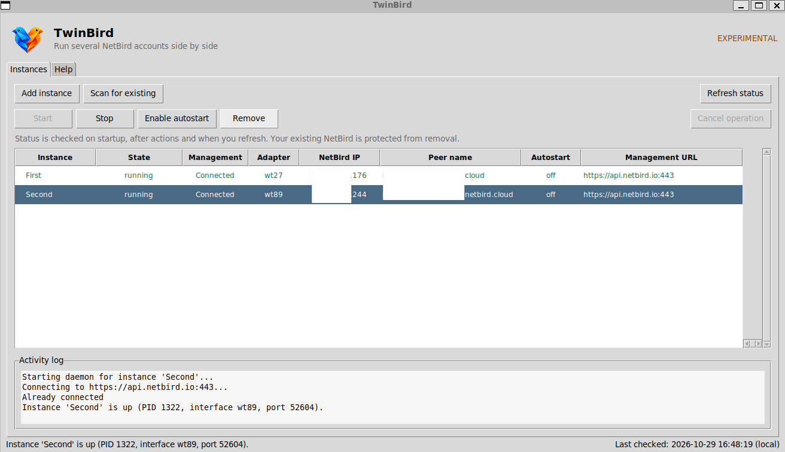

<p align="center">
  
</p>

<h1 align="center">TwinBird</h1>

<p align="center">
  <strong>Run several NetBird accounts side by side on one machine.</strong><br>
  An experimental manager for separate NetBird connections — CLI and desktop app.
</p>

<p align="center">
  <a href="https://github.com/astral-sh/ruff"></a>
  
  
  
  
</p>

<p align="center">
  
</p>

> **Experimental test project.** Builds on
> [`OseSem/twinbird`](https://github.com/OseSem/twinbird). Windows multi-instance
> has been exercised with NetBird 0.64.2; Linux and macOS remain experimental.
> Not a stable release. See [CHANGELOG.md](CHANGELOG.md).

## Why

NetBird runs one account per machine. On Windows, stock NetBird 0.64.2 requests one
fixed Wintun GUID for every interface, so a second connection cannot come up. If you
work on more than one mesh — a client's, a lab, your own — you normally tear one down
to join the other.

TwinBird keeps them running in parallel, each with its own identity, config, daemon
control channel and WireGuard interface, managed from the CLI or a small desktop app
with a tray icon. On Windows it uses a separately built, TwinBird-compatible NetBird
client (same source, a small per-instance GUID patch); your installed NetBird is
never modified.

## Install

TwinBird is **not on PyPI** — install it from this checkout. It needs a NetBird CLI
on the same platform and a setup key for a server/agent peer.

**Windows 11** (PowerShell **as administrator**, in the checkout root):

```powershell
powershell -NoProfile -ExecutionPolicy Bypass -File .\scripts\install-windows.ps1
```

One command sets up an isolated venv, builds the compatible NetBird client when it
is missing (needs Go 1.25+ and Git), puts `twinbird` on your `PATH` and adds a Start
Menu shortcut. Add `-Clean` to reinstall; uninstall with
`scripts\uninstall-windows.ps1`.

**Linux, WSL and macOS**, the separate Windows client, environment variables and
requirements: see [docs/install.md](docs/install.md).

## Quick start

```bash
# Start a named instance with a setup key
twinbird up work --management-url https://netbird.corp.example.com --setup-key YOUR_KEY

# A second account on NetBird Cloud via browser/OAuth login (omit --setup-key)
twinbird up personal --management-url https://api.netbird.io:443

# Both online and independent
twinbird list

# Status, stop, autostart, remove
twinbird status
twinbird down work
twinbird autostart work --enable
twinbird remove work

# Desktop manager (window + tray icon)
twinbird gui
```

The NetBird Cloud management URL is `https://api.netbird.io:443` (the API endpoint,
not the `app.netbird.io` dashboard). TwinBird supports server/agent peers enrolled
with a setup key, not NetBird's interactive user-device sign-up.

## Docs

- [Install & platforms](docs/install.md) — Windows client build, Linux, WSL, macOS, requirements
- [Desktop manager (GUI & tray)](docs/gui.md) — window, fields, shortcuts, tray
- [How it works](docs/how-it-works.md) — per-instance isolation, auth, env vars, internals, autostart
- [Using an existing NetBird install](docs/existing-netbird.md) — adopt your primary, peer types
- [Networking & security](docs/networking-security.md) — routing, DNS, security recommendations
- [Troubleshooting](docs/troubleshooting.md)
- [Security model](SECURITY.md) · [Changelog](CHANGELOG.md)

## License

[FSL-1.1-ALv2](LICENSE) — the Functional Source License with an Apache-2.0 future
grant. Use, modify and redistribute it for any purpose that is **not** a Competing
Use (reselling it or offering it as a competing paid product or service);
professional use, including in services you provide to others, is allowed. Each
version also becomes available under the Apache License 2.0 two years after its
release.

Builds on [OseSem/twinbird](https://github.com/OseSem/twinbird), whose original
portions remain under the MIT License (preserved as
[LICENSE.upstream](LICENSE.upstream)).
