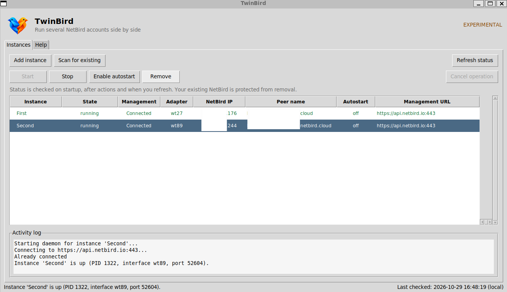

<p align="center">
  
</p>

<h1 align="center">TwinBird</h1>

<p align="center">
  <strong>Run several NetBird accounts side by side on one machine.</strong><br>
  An experimental manager for separate NetBird connections.
</p>

<p align="center">
  <a href="https://github.com/astral-sh/ruff"></a>
  
  
  
  
</p>

<p align="center">
  <em>Topics: netbird · wireguard · vpn · multi-account · system-tray · cli · windows · cross-platform</em>
</p>

---

> **Experimental test project.** This working tree builds on
> [`OseSem/twinbird`](https://github.com/OseSem/twinbird), originally created by
> OseSem. Windows multi-instance connection has been exercised with NetBird
> 0.64.2. Linux and macOS support remain experimental; see the platform notes.
> This is not a stable release. See [CHANGELOG.md](CHANGELOG.md) for changes.

> **Windows version support:** The build defaults to NetBird **0.64.2**, the
> version previously tested with multiple connections on Windows 11. It creates
> a separate client using NetBird's existing adapter-ID customization hook and
> checks that two different IDs are honored. Other release versions can be
> requested with `-Version`, but remain experimental until VPN connections have
> been tested. This does not guarantee compatibility with every NetBird release.
> Your existing NetBird installation is not replaced or modified and does not
> necessarily need to be version 0.64.2.
>
> The revised build script has built 0.64.2 and 0.64.1 successfully and checked
> two adapter IDs for each. The user subsequently reported a working connection
> with the revised 0.64.2 client. Version 0.64.1 has only passed the build and
> adapter-ID checks; routing and DNS were not independently reverified.

## Copy and paste: start TwinBird

Open a terminal **in this checkout's root directory** and use the block for your
platform. These commands require a NetBird CLI installed on that platform and a
setup key for a server/agent peer. They do not install this modified checkout from
PyPI or the original upstream repository.

| Platform | What has been checked |
|---|---|
| Windows 11 | Multi-instance connection tested with NetBird 0.64.2 and the separate TwinBird-compatible Windows client. |
| Ubuntu on WSL | Separate daemons and status queries tested; a setup-key connection was also confirmed in the GUI. Reboot persistence is unverified. |
| Native Linux | Experimental; the WSL checks do not establish native distribution compatibility. |
| macOS | Source reviewed and startup configuration covered by mocked tests. No Mac or live VPN test has been performed. |

### Windows 11

Install Python 3.10 or newer, Git, Go 1.25 or newer and NetBird first. Open
PowerShell **as administrator** in the checkout and run the installer:

```powershell
powershell -NoProfile -ExecutionPolicy Bypass -File .\scripts\install-windows.ps1
```

Add `-Clean` to remove a previous install first, or `-NoLaunch` to skip opening
the GUI at the end:

```powershell
powershell -NoProfile -ExecutionPolicy Bypass -File .\scripts\install-windows.ps1 -Clean
```

That single command does everything:

- Creates an isolated virtual environment at `%LOCALAPPDATA%\TwinBird\venv` and
  installs TwinBird with its GUI dependencies.
- Builds the separate compatible NetBird client **only** when its executable or
  Wintun DLL is missing (that step needs Go and Git; it uses the installed
  NetBird's `wintun.dll` and leaves your NetBird installation in place).
- Adds the venv's `Scripts` directory to your user `PATH`, so `twinbird` works in
  any new shell, for example `twinbird gui` or `twinbird status`. The command is
  `twinbird gui` (a subcommand), not `twinbird -gui`.
- Creates a **Start Menu** shortcut (`TwinBird`) with the app icon, so Windows
  search finds the app instead of only the folder. Pin it yourself if you want.

The shortcut and `twinbird gui` launch the manager as a detached, windowless
process (via `pythonw.exe`), so no console window lingers and closing the
PowerShell window does not stop the GUI. The shortcut is not elevated; connecting
an instance needs administrator rights. The GUI header shows whether it is
running as **Administrator** or as a **Standard user (not elevated)**, and when
not elevated it offers a **Restart as administrator** button (you can also just
launch from an elevated shell) for when you create adapters.

To uninstall, run the uninstaller from the checkout. It removes the venv, the
Start Menu shortcut and the PATH entry, and leaves your NetBird installation
untouched. Remove your instances from the GUI first so their autostart entries
and adapters are cleaned up. Add `-Purge` to also delete the config/state
directory (`%APPDATA%\twinbird`), which discards saved instances:

```powershell
powershell -NoProfile -ExecutionPolicy Bypass -File .\scripts\uninstall-windows.ps1
```

Why a separate client? Each connection needs its own adapter name **and** internal
Windows adapter ID. Separate names alone do not avoid the fixed-ID collision in
stock NetBird 0.64.2. TwinBird gives each connection its own stable ID, and this
build teaches the separate client to use it. You do not need to choose IDs yourself.

### Ubuntu and Ubuntu on WSL

Install the [NetBird Linux CLI](https://docs.netbird.io/get-started/install/linux)
inside Linux or WSL and ensure `netbird` is on `PATH`. On Ubuntu, paste this in
the checkout. On WSL, a working WSLg graphical session is required:

```bash
if ! command -v netbird >/dev/null; then
  echo 'Install the NetBird Linux CLI inside this environment first.'
elif sudo apt-get update && sudo apt-get install -y python3-venv python3-tk &&
     python3 -m venv "$HOME/.venvs/twinbird" &&
     "$HOME/.venvs/twinbird/bin/python" -m pip install -e '.[gui]'; then
  export TWINBIRD_NETBIRD_BIN="$(command -v netbird)"
  export TWINBIRD_CONFIG_DIR="${TWINBIRD_CONFIG_DIR:-$HOME/.config/twinbird}"
  sudo --preserve-env=DISPLAY,WAYLAND_DISPLAY,XDG_RUNTIME_DIR,TWINBIRD_NETBIRD_BIN,TWINBIRD_CONFIG_DIR \
    "$HOME/.venvs/twinbird/bin/twinbird" gui
else
  echo 'TwinBird installation failed; check the error above.'
fi
```

The GUI runs elevated so it can create an interface. Its configured files are
therefore root-owned. WSL displays a window without a tray icon; **Scan for
existing** searches inside WSL and does not import the Windows connection.
On Linux/WSL the GUI runs in the foreground: keep this terminal open while
using the window. Automatic background launch currently applies to Windows.
The config-directory setting preserves an existing `TWINBIRD_CONFIG_DIR` value.
Reuse the directory from previous sessions to see those saved instances; using
a different directory opens a separate local setup.

### macOS: experimental, not yet tested

Install Python with tkinter and the [NetBird macOS CLI](https://docs.netbird.io/get-started/install/macos),
and ensure both `python3` and `netbird` are on `PATH`. The following is a starting
point for a Mac test; GUI elevation, interface creation and autostart have not
been validated on macOS:

```bash
if ! command -v netbird >/dev/null; then
  echo 'Install the NetBird macOS CLI first.'
elif ! python3 -c 'import tkinter' >/dev/null 2>&1; then
  echo 'Install Python 3 with tkinter first.'
elif python3 -m venv "$HOME/.venvs/twinbird" &&
     "$HOME/.venvs/twinbird/bin/python" -m pip install -e '.[gui]'; then
  export TWINBIRD_NETBIRD_BIN="$(command -v netbird)"
  export TWINBIRD_CONFIG_DIR="$HOME/Library/Application Support/TwinBird"
  sudo --preserve-env=TWINBIRD_NETBIRD_BIN,TWINBIRD_CONFIG_DIR \
    "$HOME/.venvs/twinbird/bin/twinbird" gui
else
  echo 'TwinBird installation failed; check the error above.'
fi
```

After opening the GUI, choose **Add instance**, enter the management URL and a
setup key, then connect. For NetBird Cloud the URL is
`https://api.netbird.io:443`. Each new instance registers a separate peer.

Run multiple [NetBird](https://netbird.io) instances on a single machine, each with
its own identity, configuration, daemon control channel, and WireGuard interface.
On Windows, stock NetBird 0.64.2 requests one fixed Wintun GUID for every
interface. Additional simultaneous instances require the separately built
TwinBird-compatible client described below.

Each named instance gets its own interface (with automatic collision
avoidance) and control channel. Manage them from the command line or from the
small desktop app and system-tray icon (`twinbird gui`).

TwinBird orchestrates NetBird daemons. On Windows 0.64.2 it uses a separate
client built from NetBird's source with a small per-instance GUID patch. It does
not replace or modify your installed NetBird executable or its configuration.

### Supported NetBird peer type

For an imported **primary**, **Stop** disconnects its VPN while the existing
NetBird service keeps running. After refresh, **Start** reconnects through that
same daemon; a disconnected service is shown as `disconnected (existing)`.
TwinBird does not replace the primary service or change its autostart. If the
service itself has been stopped outside TwinBird, start it through the operating
system's service manager first. In WSL, an imported primary belongs to Linux;
it is separate from the Windows NetBird installation.

TwinBird is for **server/agent peers enrolled with a setup key**. It does not
implement NetBird's interactive **user-device** sign-up and login flow. In
particular, the NetBird agent onboarding steps below are not supported by
TwinBird:

**2** Click **Connect** from the NetBird icon in the system tray.<br>
**3** Sign up using your email address.

Those steps start NetBird's user-device flow; TwinBird does not create or manage
that kind of peer. Create a setup key in the NetBird dashboard and use it when
adding a TwinBird instance. The optional browser/OAuth path is experimental and
does not add user-device support.

## Requirements

- [NetBird](https://netbird.io) installed and on `PATH` (or point TwinBird at it
  with `TWINBIRD_NETBIRD_BIN`).
- Python 3.10 or newer.
- Windows 11 is the primary tested target. Linux and macOS are experimental.

## Install this experimental checkout

Use this working tree or a clone containing these changes. Installing `twinbird`
from PyPI or cloning upstream installs the original project, not this version.
The `[gui]` extra installs the modern Sun Valley theme (`sv-ttk`) and the optional
tray dependencies (`pystray`, `Pillow`); tkinter is also needed. Without the extra
the window still works, using the default Tk theme and no tray.
This installs the Python application and dependencies only. It does **not**
build or install the separate Windows NetBird client described below.

```bash
cd twinbird
pip install -e ".[gui]"
```

Then launch the desktop manager:

```bash
twinbird gui
```

## Quick start

```bash
# Start a named instance (setup key)
twinbird up office --management-url https://mgmt.example.com --setup-key YOUR_KEY

# Start a named instance (interactive OAuth login; omit --setup-key)
twinbird up personal --management-url https://netbird.example.net

# Status of one or all instances
twinbird status office
twinbird status

# List all known instances and their state
twinbird list

# Stop an instance
twinbird down office

# Enable or disable start-on-boot for an instance
twinbird autostart office --enable
twinbird autostart office --disable

# Remove an instance and delete its local state
twinbird remove office

# Open the desktop manager (tray icon + window)
twinbird gui
```

## Example: one personal and one professional account

The whole point of TwinBird is running two accounts at once. Give each a distinct
name; everything else (interface, control channel, config) is derived and isolated
automatically.

```bash
# Professional account, enrolled with a setup key
twinbird up work \
  --management-url https://netbird.corp.example.com \
  --setup-key XXXXXXXX-XXXX-XXXX-XXXX-XXXXXXXXXXXX

# Personal account on NetBird Cloud, enrolled via browser OAuth (no key)
twinbird up personal \
  --management-url https://api.netbird.io:443

# Confirm both are up and independent
twinbird list
#   personal: running (persistent)
#   work: running (persistent)
```

Multiple interfaces, permissions and persistence require platform-specific
verification; see the Windows and Linux notes below before relying on them.

See "Network routing considerations" below before relying on both default routes or
DNS management at the same time.

## Desktop manager (GUI and tray)

`twinbird gui` opens a small, dependency-light desktop manager. On Windows the
GUI starts in its own process and returns you to the PowerShell prompt immediately.
The Instances and Help tabs use the same page size, including when the window is resized.

### Step by step

1. Install NetBird (https://netbird.io) so the `netbird` command is available.
2. Run `twinbird gui`. A window opens; a tray icon appears when supported
   (bottom-right on Windows). WSL runs without a tray icon.
3. Click **Add instance** and fill in the form (fields explained below).
4. Click **Add & connect**. A setup key is the most direct GUI login method;
   browser login without a key has not been validated on every platform.
5. The instance appears in the list as *running*. Repeat for each account.

### The window

- Compact default window (960 pixels wide), smaller controls and scalable table
  columns. The window can be reduced to 640 × 460 pixels; the horizontal
  scrollbar does not lock its width. Toggle **Details** and **Log** in the toolbar
  to hide the lower panels and give more space to the instance list.
- Modern Sun Valley theme with a **Dark mode / Light mode** button in the header.
  The initial theme follows your OS setting (Windows, macOS, and GNOME-based Linux);
  elsewhere it starts light and you switch with the button. Install with the
  `[gui]` extra so the theme is available (otherwise the default Tk theme is used).
- A tab with every instance: its daemon **state**, **Management** connection,
  network **adapter**, NetBird **IP**,
  peer **name** and **autostart** status. A selected-connection panel shows the
  management URL, stable instance ID, ownership, control address, WireGuard port
  and PID when available. Unknown values are shown explicitly.
- Select an instance to enable its actions (double-click a row to start/stop it):
  - **Start / Stop** - connect or disconnect that instance.
  - **Rename** - change the local display name, including spaces. This works
    while connected and also for an adopted primary. It does not rename the
    peer in the NetBird dashboard. The internal ID, identity files, adapter ID
    and startup paths remain stable, so no reconnect or setup key is needed.
  - **Enable / Disable autostart** - reconnect automatically after you sign in.
  - **Remove** - disconnect and delete a TwinBird-managed instance's local
    settings and autostart. The adopted primary is protected and cannot be removed.
- **Scan for existing** finds the NetBird already installed on this PC and adds it
  to the list as an adopted instance (read-only toward the primary - see below).
- **Add instance** and **Refresh** are available when no action is running.
- **Enter** on a selected row connects/disconnects it. Enter also submits the
  add dialog and activates a focused button. **F2** renames, **F5** refreshes,
  and **Escape** requests cancellation of a pending connection.
- Right-click a row to rename it or copy its IP, peer name or connection details.
  **Ctrl+C** in the table copies details; **Cmd+C** is also supported on macOS.
- Vertical scroll controls stay beside the rows and the horizontal scrollbar
  stays below them. Details and the scrollable activity log remain visible when
  resizing; the table gets the remaining space. Windows display scaling is
  enabled for sharper text and controls.
- The **Instances** and **Help** tab buttons have equal width and height. Selecting
  a tab changes its colour without changing its dimensions. Both pages keep the
  same window size when you switch between them; buttons use compact spacing.
- Status is a snapshot checked at startup, after an action, or when you click
  **Refresh status**. The bottom bar shows when the check finished. Management
  is `Unknown` if a NetBird status query could not be read. A running daemon is
  not by itself proof that Management or a peer is reachable.
- **Cancel operation** is enabled during a connection attempt and stops the pending
  NetBird CLI request and its temporary TwinBird daemon.
- An **activity log** at the bottom shows what each action did.
- A **Help** tab explains everything inside the app.

NetBird uses WireGuard connections between peers, preferring a direct P2P path
and falling back to a relay when necessary. Setup-key registration and the
Management column concern the control plane; they do not prove that a specific
peer connection is direct. TwinBird preserves this NetBird behavior and does not
automatically bridge its separate accounts. See [how NetBird works](https://docs.netbird.io/about-netbird/how-netbird-works).

<p align="center">
  
</p>

*Earlier GUI session in WSL, before the current layout refresh. WSLg displays
the window without a system-tray icon.*

### Add-instance fields

| Field | What to enter |
|---|---|
| **Name** | A label you choose, e.g. `work` or `personal`. Letters, digits, `-`, `_`. |
| **Management URL** | Your NetBird management server. **NetBird Cloud: `https://api.netbird.io:443`** (the API endpoint, not the `app.netbird.io` dashboard). Self-hosted: your own server, e.g. `https://netbird.example.com:443`. If NetBird is already configured on this PC, TwinBird pre-fills this automatically; otherwise it defaults to the Cloud URL. |
| **Setup key** | Required for the supported server/agent enrollment. Create one in the NetBird dashboard under *Setup Keys*. User-device email sign-up is not supported. |
| **Interface** (optional) | The WireGuard adapter name. **Leave blank** so TwinBird picks a free one automatically (recommended). |

### Tray icon

Left-click the tray icon (or use its menu) to open the manager, toggle any instance
on or off directly, or quit. Closing the window hides it back to the tray; your
instances keep running.

### Notes

- The window uses tkinter (bundled with Python). The `twinbird[gui]` extra adds the
  modern Sun Valley theme (`sv-ttk`) and the system-tray icon (`pystray` + `Pillow`);
  without it the window still works, falling back to the default Tk theme and no tray.
- All GUI actions run through the same core as the CLI, on background threads, so
  the window stays responsive. A setup key is passed in a temporary file rather
  than on the command line. POSIX permissions are owner-only; Windows inherits the
  instance directory's ACL. On Windows
  the GUI detaches from its launching console, so closing an elevated PowerShell
  window does not close TwinBird.

## Using an existing NetBird install

TwinBird does not change the existing NetBird installation or its configuration.
If you choose Start or Stop on an adopted instance, that command does affect its
existing connection; the GUI asks for confirmation first.

- **Integrate it (no re-adding).** Click **Scan for existing** in the GUI (or run
  `twinbird import`) to adopt your current NetBird as an instance. TwinBird points
  at its already-running daemon instead of starting a second one, so it is not a
  duplicate and you do not re-authenticate. Scanning twice does not add it again.
  An adopted instance shows autostart as `service` (owned by NetBird, not
  TwinBird). Remove is disabled for this entry, including through the CLI.
- **Detection (read-only).** TwinBird looks for the primary NetBird config
  (`C:\ProgramData\Netbird\default.json` on Windows, `/var/lib/netbird/default.json`
  on Linux/macOS) and, if it can read it, pre-fills the correct management URL in
  the Add dialog and uses it when adopting. It never writes to that file. On
  Windows the primary config is usually restricted to SYSTEM/Administrators, so
  this needs an elevated (administrator) TwinBird; otherwise the correct Cloud URL
  is used by default.
- **Remote peers.** Removing a managed instance deletes its local state and
  startup entry; it does not delete the peer from the NetBird dashboard. Remove
  that peer in the dashboard separately if needed.
- **No collisions.** TwinBird keeps every new instance off your primary's network
  adapter (usually `wt0`) and WireGuard UDP port (usually `51820`). Each instance
  gets its own adapter name and a unique port, so your existing connection stays
  stable.
- **NetBird stays in charge.** TwinBird does not disable DNS, SSH, the network
  monitor, MTU or routing. Those remain NetBird's own defaults/settings; TwinBird
  only sets the per-instance daemon address, adapter and port.
- **Separate identity.** Each instance is still its own NetBird peer, so it needs
  its own login or setup key. That is a NetBird requirement: the same identity
  cannot run on two interfaces at once.

### Windows multi-instance limitation

NetBird 0.64.2's Windows TUN implementation requests the same fixed Wintun GUID
for every interface. Windows rejects the second adapter even when TwinBird gives
it a different name such as `wt34` and the process is elevated. Authentication
can register a peer before adapter creation fails, leaving a recently seen peer
in the NetBird dashboard without a working local interface. Administrator rights
do not resolve this GUID collision. Windows multi-instance support requires a
NetBird client build that reads a per-instance Wintun GUID from
`TWINBIRD_WINTUN_GUID`. TwinBird supplies a build script at
`scripts/build-netbird-windows.ps1`, defaulting to NetBird 0.64.2. Install Go 1.25 or newer
and Git, then run the script once from the checkout in PowerShell:

```powershell
.\scripts\build-netbird-windows.ps1
twinbird gui
```

The script adds a small Windows initialization file that passes the instance ID
to NetBird's existing `CustomWindowsGUIDString` hook. It does not search and
replace NetBird function bodies. It checks the release tag and source commit,
builds to a temporary output, and verifies two IDs through NetBird's actual GUID
function before publishing `dist/netbird-twinbird.exe`. If compilation or the
GUID checks fail, the previous executable is kept. These checks create no
adapter and do not authenticate a peer.

To try another published release, pass `-Version` with its numeric release
version. The script checks that the required hook still compiles and works;
this is not proof of VPN, DNS, routing, or CLI compatibility. Only 0.64.2 has
previously been tested with Windows multi-instance connections. Existing
modified source directories are rejected rather than overwritten; use a fresh
`-SourcePath` if needed. The old `netbird-twinbird-0.64.2.exe` remains a fallback
for editable installs when the new executable is absent.

`pip install -e ".[gui]"` does not run this script. The resulting `dist` files
are local build outputs and are not included in a Git checkout or Python wheel.
If the compatible executable and `wintun.dll` are already present in `dist`,
you can launch TwinBird without building them again. Start the GUI as an
administrator to allow adapter creation.

An editable checkout discovers the default binary in `dist` automatically.
An explicitly set `TWINBIRD_NETBIRD_BIN` takes precedence; set it to the
compatible executable if you use a different location:

```powershell
$env:TWINBIRD_NETBIRD_BIN = "C:\path\to\netbird-twinbird.exe"
twinbird gui
```

The build script copies `wintun.dll` from the installed NetBird directory next
to the custom executable; use `-WintunDllPath` if the DLL is elsewhere. The
installed NetBird executable and its files are not changed. The build step is
specific to Windows; it is not required for Linux or WSL.

TwinBird assigns a stable unique GUID to each instance. Keep the custom binary
selected for the TwinBird GUI and its managed instances; the stock binary ignores
the per-instance GUID variable.

## Authentication methods

- Setup key: use the GUI or `TWINBIRD_SETUP_KEY` to avoid putting the secret on
  TwinBird's command line. TwinBird passes it to NetBird through a temporary
  `--setup-key-file` and deletes the file after use. The CLI also accepts
  `--setup-key`, which exposes the value in TwinBird's own process arguments.
- OAuth / SSO: omit the setup key for the interactive CLI flow. GUI browser login
  is experimental.

## Environment variables

```bash
export TWINBIRD_MANAGEMENT_URL=https://mgmt.example.com
export TWINBIRD_SETUP_KEY=YOUR_KEY
twinbird up office
```

| Variable | Purpose |
|---|---|
| `TWINBIRD_MANAGEMENT_URL` | Default management URL |
| `TWINBIRD_SETUP_KEY` | Default setup key |
| `TWINBIRD_NETBIRD_BIN` | Path to the netbird binary (default: `netbird` on `PATH`) |
| `TWINBIRD_CONFIG_DIR` | Override the root config directory |

## How it works

Each named instance gets:

- Its own config directory: `%APPDATA%\twinbird\<name>\` on Windows,
  `~/.config/twinbird/<name>/` on Linux and macOS (owner-only on POSIX).
- Its own NetBird state and profile directory via `NB_STATE_DIR`. On Windows,
  `%PROGRAMDATA%` is also redirected for the managed daemon.
- Its own daemon control channel: a loopback TCP port on Windows, or a Unix
  socket on Linux and macOS. Windows avoids the stock port 41731.
- Its own WireGuard interface name (`wt<N>`, `utun<N>` on macOS) and its own
  WireGuard UDP port, both with collision avoidance against the primary and other
  instances.

TwinBird launches a dedicated `netbird service run` daemon per instance, then runs
`netbird up` against that daemon, fully isolated from the primary NetBird install.

> **Administrator / root is required** to create a WireGuard network adapter on
> Windows (and root on Linux). Run TwinBird elevated, or the daemon connects but
> fails at "creating interface: Access is denied".
>
> On Windows, administrator rights do not bypass the stock NetBird 0.64.2 fixed
> Wintun GUID limitation described above.

### Linux experimental support

NetBird 0.64.2 reads `NB_STATE_DIR` at process startup. TwinBird sets it to each
instance directory for both daemon and client commands, and writes it into the
systemd user unit. This avoids sharing `/var/lib/netbird` with the primary daemon.
The installed `netbird` binary is used directly on Linux. A local Ubuntu WSL
smoke check started two unauthenticated NetBird 0.64.2 daemons, verified their
separate state directories and Unix sockets, and queried each daemon's status. It
did not create a WireGuard adapter or establish a VPN connection. To repeat the
check on Linux with a NetBird binary, run:

```bash
python3 scripts/linux-smoke.py "$(command -v netbird)"
```

WSL has its own Linux filesystem, processes and NetBird state. **Scan for existing**
inside WSL can only adopt a NetBird installation inside WSL; it cannot detect or
adopt the Windows NetBird client. Use **Add instance** with a setup key to enroll a
separate WSL peer.

Creating a WireGuard interface normally requires root or suitable Linux
capabilities. A systemd user service does not automatically receive those
privileges. User-bus availability, linger, capabilities, GUI access under
elevation, routing and DNS must be checked on the target distribution. Linux
multi-account connectivity and persistence have not yet been verified end to end.

#### Run the GUI in WSL

WSLg can display TwinBird's window, but WSL does not provide the system tray
manager used by the optional tray icon. TwinBird detects WSL and runs in
window-only mode. Install the NetBird Linux CLI inside WSL; this is a separate
Linux installation and peer from NetBird running on Windows. Follow the
[official NetBird Linux installation guide](https://docs.netbird.io/get-started/install/linux).

From the TwinBird checkout inside WSL, install Tk and TwinBird's GUI extra:

```bash
sudo apt update
sudo apt install -y python3-venv python3-tk
python3 -m venv ~/.venvs/twinbird
~/.venvs/twinbird/bin/pip install -e ".[gui]"
```

Launch the GUI with permission to create a WireGuard interface. The environment
variables keep TwinBird's WSL configuration separate and point it at the NetBird
binary installed inside WSL:

```bash
export TWINBIRD_NETBIRD_BIN="$(command -v netbird)"
export TWINBIRD_CONFIG_DIR="${TWINBIRD_CONFIG_DIR:-$HOME/.config/twinbird}"
sudo --preserve-env=DISPLAY,WAYLAND_DISPLAY,XDG_RUNTIME_DIR,TWINBIRD_NETBIRD_BIN,TWINBIRD_CONFIG_DIR \
  "$HOME/.venvs/twinbird/bin/twinbird" gui
```

Use the same `TWINBIRD_CONFIG_DIR` as your previous sessions if you already have
instances. For a disposable test you can set it to a separate `/tmp` directory
before running these commands; `/tmp` state may disappear after a reboot.

In the GUI, choose **Add instance** and enter a setup key for a server/agent peer.
Skip **Scan for existing** unless you already have a NetBird installation inside
WSL; that scan cannot see your Windows NetBird client. Removing the TwinBird
instance deletes its local state, while its remote peer must be removed separately
in the NetBird dashboard.

### macOS feasibility and limits

NetBird 0.64.2's macOS client creates `utun` interfaces, and its profile code
honours `NB_STATE_DIR`. TwinBird assigns an interface name and isolated state
directory per instance, and includes that directory in the launchd configuration.
The implementation avoids loading a second launchd daemon while the same
instance's control socket is already active.

These are source-level and mocked checks, not a live Mac validation. In particular,
macOS may already use a selected `utun` number, and GUI elevation, route and DNS
interactions, launchd permissions and reconnect after login require testing. Treat
macOS support and autostart as experimental until those checks succeed.

## Autostart (experimental)

On a successful `up`, TwinBird attempts to register a per-instance startup entry.
`twinbird down` removes it. Registration and reconnect after reboot depend on
the platform and permissions; verify them on your machine.

- Windows: a hidden Task Scheduler task (`twinbird-<name>`) triggered at logon,
  running with highest available privileges. Registering it may prompt once for
  UAC elevation. If a task was created by an older checkout, disable and then
  enable autostart for that instance to regenerate it with its isolated paths.
- Linux: a systemd user unit (`twinbird-<name>.service`). User units only start at
  boot if lingering is enabled for your account, and still need permission to
  create the network interface:
  ```bash
  loginctl enable-linger "$USER"
  ```
- macOS: a launchd user agent (`com.twinbird.<name>.plist`) with `RunAtLoad` and
  `KeepAlive`.

## Troubleshooting

- `netbird not found on PATH`: install NetBird or set `TWINBIRD_NETBIRD_BIN` to the
  full path of the binary.
- Daemon fails to start: TwinBird prints the tail of `daemon.log` from the instance
  directory. Inspect that file for the NetBird error.
- Instance shows `stopped` but you expected it up: run `twinbird status <name>` to
  query NetBird directly; check the autostart entry still exists.
- `creating interface: Access is denied` (Windows) or interface errors on Linux:
  the daemon connected but could not create the WireGuard adapter. Run TwinBird as
  administrator (Windows) or root (Linux).
- `Cannot create a file when that file already exists` while creating a second
  Windows interface on stock NetBird 0.64.2: this is a fixed Wintun GUID collision,
  not an elevation failure. The GUI/CLI now explain the limitation before sending
  a setup key when the installed client version and existing interface are known.
- `setup key is invalid`: setup keys can be single-use or expired. Generate a fresh
  key in the dashboard, or leave the key blank to log in via your browser.
- Linux user service does not survive reboot: enable lingering (see Autostart).
- "refusing to overwrite config.json" on `up`: an existing `config.json` in the
  instance directory is corrupt. It may contain the WireGuard private key, so
  TwinBird will not clobber it. Inspect and remove it manually, then retry.

## Network routing considerations

TwinBird isolates identities, configs, interfaces, and control channels, but the
host has one routing table and one DNS stack that both instances share. NetBird (not
TwinBird) manages routes and DNS. When running two accounts at once:

- Prefer non-overlapping peer address ranges per account where you control them.
  Overlap (including the default `100.64.0.0/10` range on both) can cause route and
  address conflicts.
- If both networks push a default route, or overlapping advertised subnets, they
  contend. Disable server routes on one instance if needed:
  the instance's NetBird config / `netbird up --disable-server-routes`.
- If DNS resolution misbehaves with both up, consider `--disable-dns` on one
  instance so only one instance manages the system resolver.
- TwinBird never enables IP forwarding and never creates routes between the two
  networks. For strict isolation, run each account in a separate OS user, VM, or
  network namespace.

See [SECURITY.md](SECURITY.md) for the full security model and boundaries.

## Security recommendations

- Do not run untrusted code under the same user account as your TwinBird instances;
  any same-user process can reach the NetBird control channel (this is NetBird's
  model).
- Keep secret setup keys out of shell history; prefer `TWINBIRD_SETUP_KEY` from a
  protected environment file, or OAuth login.
- On POSIX, TwinBird keeps instance files owner-only; do not loosen the config
  directory permissions.

## Upgrading

- Update this checkout and reinstall it with `pip install -e ".[gui]"`.
- Upgrading NetBird can change compatibility. On Windows the separate patched
  client is pinned to 0.64.2; rebuild and verify compatibility before upgrading it.
- Instance metadata is forward-compatible: older `instance.json` files load, and
  unknown fields from newer versions are ignored.

## License

This project is licensed under the
[PolyForm Noncommercial License 1.0.0](LICENSE). Any noncommercial use is free.
Commercial use (selling it, shipping it in a paid product or service, or using it
to generate revenue) requires a separate written commercial license from the
copyright holder.

It builds on [OseSem/twinbird](https://github.com/OseSem/twinbird), whose original
portions remain available from that project under the MIT License (preserved here
as [LICENSE.upstream](LICENSE.upstream)). The terms in [LICENSE](LICENSE) govern
this continuation and all changes made to it.
