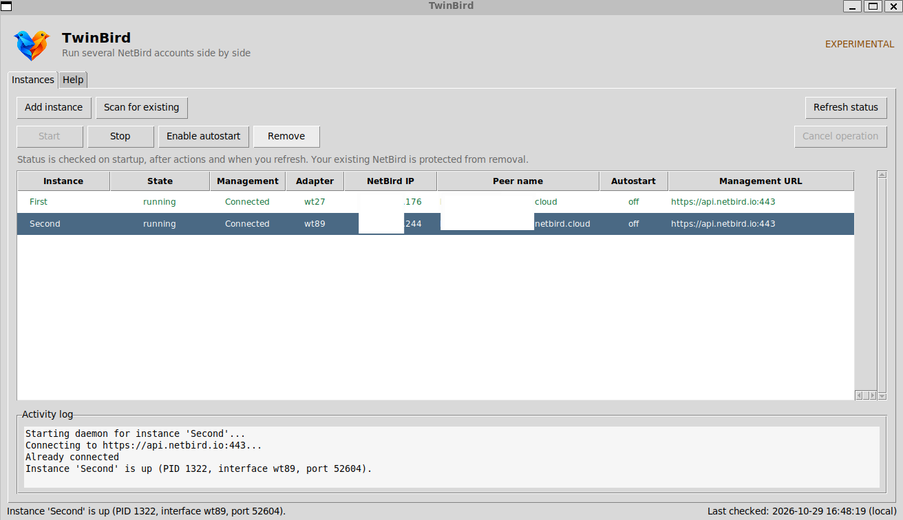

# Desktop manager (GUI and tray)

`twinbird gui` opens a small, dependency-light desktop manager. On Windows the
GUI starts in its own process and returns you to the PowerShell prompt immediately.
The Instances and Help tabs use the same page size, including when the window is resized.

  

*Earlier GUI session in WSL, before the current layout refresh. WSLg displays
the window without a system-tray icon.*

## Step by step

1. Install NetBird (https://netbird.io) so the `netbird` command is available.
2. Run `twinbird gui`. A window opens; a tray icon appears when supported
   (bottom-right on Windows). WSL runs without a tray icon.
3. Click **Add instance** and fill in the form (fields explained below).
4. Click **Add & connect**. A setup key is the most direct GUI login method;
   browser login without a key has not been validated on every platform.
5. The instance appears in the list as *running*. Repeat for each account.

## The window

- Compact default window (960 pixels wide), smaller controls and scalable table
  columns. The window can be reduced to 640 × 460 pixels; the horizontal
  scrollbar does not lock its width. Toggle **Details** and **Log** in the toolbar
  to hide the lower panels and give more space to the instance list.
- Modern Sun Valley theme with a **Dark mode / Light mode** button in the header.
  The initial theme follows your OS setting (Windows, macOS, and GNOME-based Linux);
  elsewhere it starts light and you switch with the button. Install with the
  `[gui]` extra so the theme is available (otherwise the default Tk theme is used).
- The header also shows whether TwinBird is running as **Administrator** /
  **Root** or as a standard (not elevated) user.
- A tab with every instance: its daemon **state**, **Management** connection,
  network **adapter**, NetBird **IP**,
  peer **name** and **autostart** status. A selected-connection panel shows the
  management URL, stable instance ID, ownership, control address, WireGuard port
  and PID when available. Unknown values are shown explicitly.
- Select an instance to enable its actions (double-click a row to start/stop it):
  - **Start / Stop** - connect or disconnect that instance.
  - **Rename** - change the local display name, including spaces. This works
    while connected and also for an adopted primary. It does not rename the
    peer in the NetBird dashboard. The internal ID, identity files, adapter ID
    and startup paths remain stable, so no reconnect or setup key is needed.
  - **Enable / Disable autostart** - reconnect automatically after you sign in.
  - **Remove** - disconnect and delete a TwinBird-managed instance's local
    settings and autostart. The adopted primary is protected and cannot be removed.
- Select the original NetBird row and click **Switch NetBird profile...** to
  select another profile in the original client. The original connection briefly
  disconnects and the selected profile also changes in the NetBird app. Local
  aliases show the original profile name in parentheses.
- **Scan for existing** finds the NetBird already installed on this PC and adds it
  to the list as an adopted instance (read-only toward the primary - see below).
- **Add instance** and **Refresh** are available when no action is running.
- **Enter** on a selected row connects/disconnects it. Enter also submits the
  add dialog and activates a focused button. **F2** renames, **F5** refreshes,
  and **Escape** requests cancellation of a pending connection.
- Right-click a row to rename it or copy its IP, peer name or connection details.
  **Ctrl+C** in the table copies details; **Cmd+C** is also supported on macOS.
- Vertical scroll controls stay beside the rows and the horizontal scrollbar
  stays below them. Details and the scrollable activity log remain visible when
  resizing; the table gets the remaining space. Windows display scaling is
  enabled for sharper text and controls.
- The **Instances** and **Help** tab buttons have equal width and height. Selecting
  a tab changes its colour without changing its dimensions. Both pages keep the
  same window size when you switch between them; buttons use compact spacing.
- Status is a snapshot checked at startup, after an action, or when you click
  **Refresh status**. The bottom bar shows when the check finished. Management
  is `Unknown` if a NetBird status query could not be read. A running daemon is
  not by itself proof that Management or a peer is reachable.
- **Cancel operation** is enabled during a connection attempt and stops the pending
  NetBird CLI request and its temporary TwinBird daemon.
- An **activity log** at the bottom shows what each action did.
- A **Help** tab explains everything inside the app.

NetBird uses WireGuard connections between peers, preferring a direct P2P path
and falling back to a relay when necessary. Setup-key registration and the
Management column concern the control plane; they do not prove that a specific
peer connection is direct. TwinBird preserves this NetBird behavior and does not
automatically bridge its separate accounts. See
[how NetBird works](https://docs.netbird.io/about-netbird/how-netbird-works).

## Add-instance fields

| Field | What to enter |
|---|---|
| **Name** | A label you choose, e.g. `work` or `personal`. Letters, digits, `-`, `_`. |
| **Management URL** | Your NetBird management server. **NetBird Cloud: `https://api.netbird.io:443`** (the API endpoint, not the `app.netbird.io` dashboard). Self-hosted: your own server, e.g. `https://netbird.example.com:443`. If NetBird is already configured on this PC, TwinBird pre-fills this automatically; otherwise it defaults to the Cloud URL. |
| **Setup key** | Required for the supported server/agent enrollment. Create one in the NetBird dashboard under *Setup Keys*. User-device email sign-up is not supported. |
| **Interface** (optional) | The WireGuard adapter name. **Leave blank** so TwinBird picks a free one automatically (recommended). |

## Tray icon

Left-click the tray icon (or use its menu) to open the manager, toggle any instance
on or off directly, or quit. Closing the window hides it back to the tray; your
instances keep running.

## Notes

- The window uses tkinter (bundled with Python). The `twinbird[gui]` extra adds the
  modern Sun Valley theme (`sv-ttk`) and the system-tray icon (`pystray` + `Pillow`);
  without it the window still works, falling back to the default Tk theme and no tray.
- All GUI actions run through the same core as the CLI, on background threads, so
  the window stays responsive. A setup key is passed in a temporary file rather
  than on the command line. POSIX permissions are owner-only; Windows inherits the
  instance directory's ACL. On Windows the GUI detaches from its launching console,
  so closing an elevated PowerShell window does not close TwinBird.
